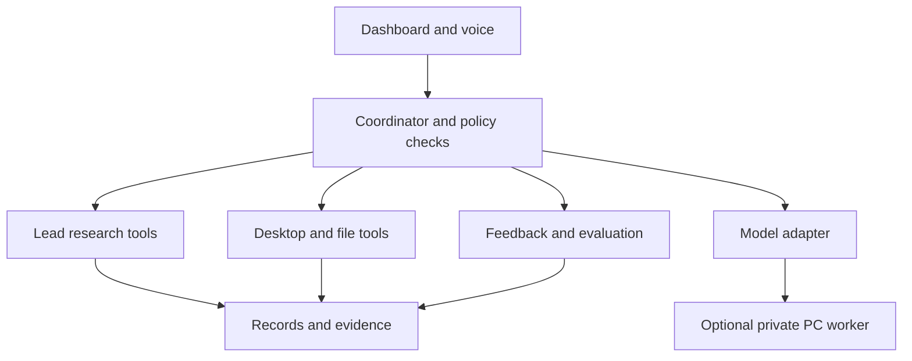

# Architecture

## Decision: modular monolith with an optional worker
Python/FastAPI backend owns workflows and data. React/Vite provides panels. SQLite with full-text search stores initial records. A worker executes persistent jobs in the same installation. Ollama is one replaceable local inference adapter. Playwright is a fallback for pages requiring a browser. Start with HTTP fetching and parsing.

A later small desktop shell or tray bridge provides hotkeys, notifications and OS integrations. Evaluate a Tauri shell only when needed; native permissions and packaging need an Ubuntu prototype. Do not add a large Electron runtime solely for a popup.

## Module boundaries
| Module | Owns | Must not own |
|---|---|---|
| Campaigns | Product brief, targeting, workflow state | Sending email directly |
| Discovery | Source queries and candidate URLs | Declaring purchase intent |
| Evidence | Fetching, excerpts, hashes, timestamps | Inventing missing sources |
| Identity | Business/branch/contact attribution | Automatically merging ambiguous entities |
| Analysis | Grounded fit hypotheses | Unchecked numeric probabilities |
| Desktop | Approved local tools and context | Unrestricted shell execution |
| Memory | Scoped facts/preferences/corrections | Secret credentials |
| Learning | Dataset versions and evaluations | Unreviewed production weight changes |
| Integrations | Provider adapters and scoped credentials | Domain business decisions |

## Execution design
Explicit workflow states: queued → running → awaiting_input / retry_wait → completed / partial / failed / cancelled. Persist each step and artefact. Jobs have an idempotency key, attempt count, lease owner, lease expiry, heartbeat and cancellation flag. A worker crash expires its lease; another worker resumes safe unfinished steps. External effects require their own idempotency and reconciliation.

Retry timeouts/429/temporary 5xx with bounded exponential backoff and jitter. Respect provider retry guidance. Authentication failures require reconnection; prohibited or blocked access must not trigger evasion. Cap retries and page count. Partial evidence remains available but is labelled incomplete.

## Scale path
Phase 1: one local user, one writer, one inference slot, one browser context at a time.
Phase 2: optional PC worker connected through authenticated private networking. Coordinator remains data owner; workers receive bounded jobs and return results. Never share the SQLite file over a network filesystem.
Phase 3: measured multi-user demand justifies PostgreSQL, a broker, tenant isolation and separate workers. Migrate repositories behind interfaces; avoid writing a distributed system before load exists.

## Suggested code layout
- apps/web — frontend panels
- apps/desktop — optional tray/OS bridge
- backend/api — typed HTTP endpoints
- backend/domain — business records and policies
- backend/workflows — persisted job state machines
- backend/adapters — model, search, browser, email, calendar, OS
- backend/storage — repositories and migrations
- backend/evaluation — repeatable test runners
- tests/fixtures — synthetic HTML, documents and provider responses
- planning — this documentation

Separate orchestration from model reasoning. One model can serve several logical roles sequentially; roles do not require separate always-running agents.
